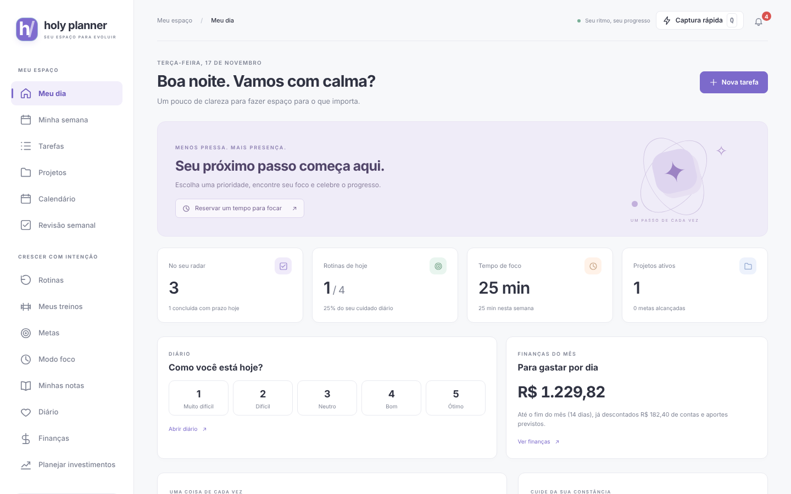
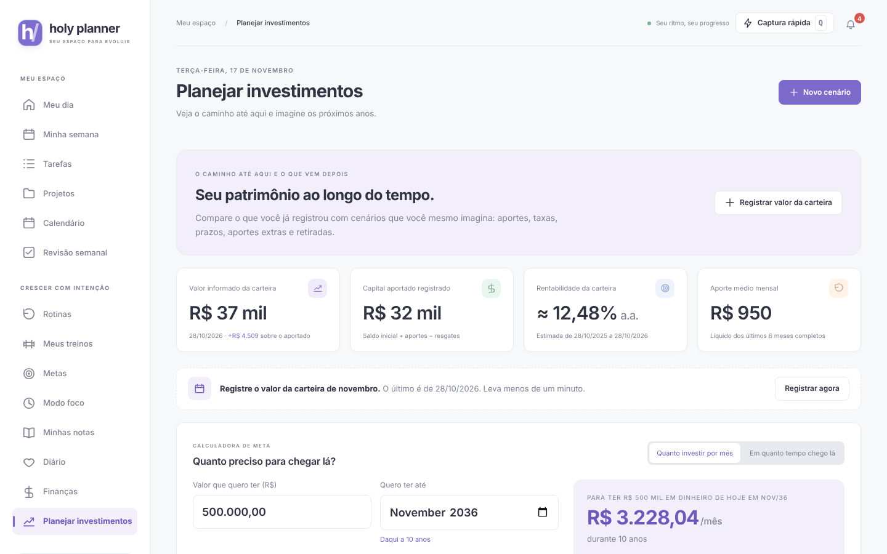
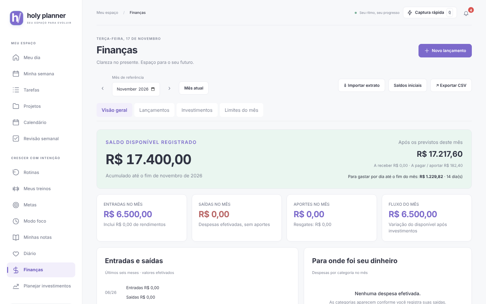
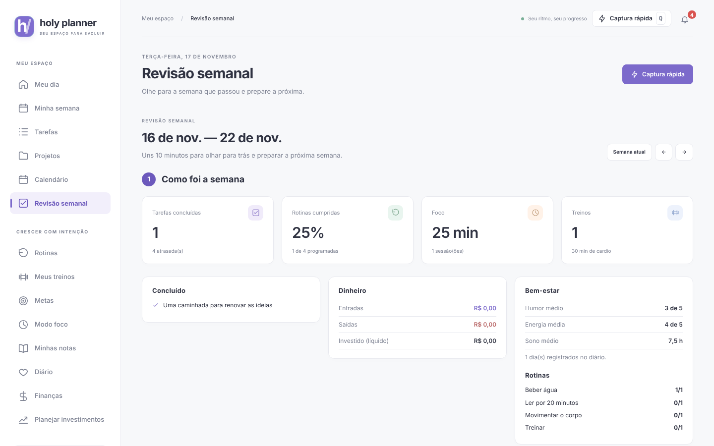
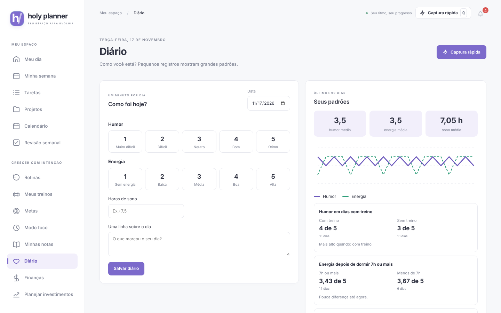
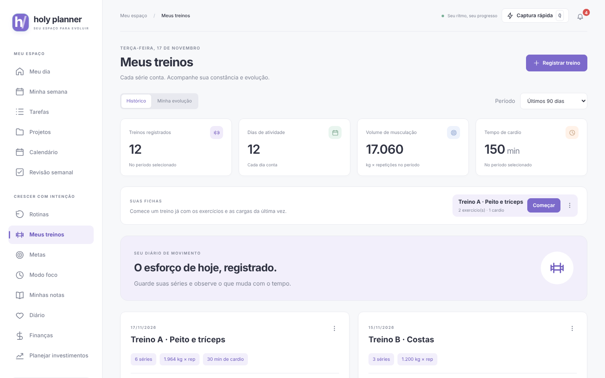
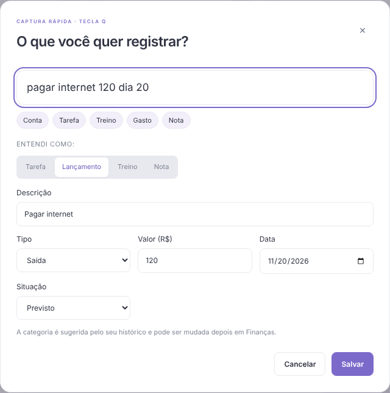

<div align="center">


# Holy Planner

**Um organizador pessoal para Windows que junta tarefas, rotinas, treinos, finanças e investimentos em um só lugar — com os dados no seu computador.**


</div>



O Holy Planner nasceu para organizar uma rotina real: o que fazer hoje, os hábitos da semana, os treinos da academia, o dinheiro do mês e o patrimônio dos próximos anos. Ele roda como **aplicativo de janela no Windows** e também pode ser aberto **no celular**, pela rede de casa. Não tem conta, não tem nuvem, não tem anúncio: tudo fica em um banco SQLite no seu computador.

> As imagens deste README usam apenas dados fictícios de demonstração.

## Recursos

**Planejar o dia e a semana**
- **Meu dia:** prioridades, rotinas, metas, tempo de foco, humor do dia e quanto ainda dá para gastar no mês.
- **Tarefas e projetos:** lista ou quadro (A fazer, Em andamento, Concluído), prazos, horários e estimativas.
- **Minha semana e calendário:** visão semanal e mensal, com eventos do Google Agenda (opcional).
- **Revisão semanal guiada:** como foi a semana, o que aprendeu e o plano da próxima, com três prioridades.

**Crescer com intenção**
- **Rotinas** por dia da semana, com progresso semanal.
- **Metas** que se atualizam sozinhas a partir de treinos, minutos de foco, rotinas ou valor da carteira.
- **Modo foco** (pomodoro) com histórico.
- **Diário** de humor, energia e sono, mostrando padrões (ex.: humor em dias com treino).
- **Meus treinos:** musculação e cardio, fichas (Treino A, B, C), sugestão de carga, cronômetro de descanso e gráficos de evolução.

**Dinheiro**
- **Finanças:** entradas, saídas, aportes, previsto × efetivado, limites por categoria, lançamentos que se repetem, exportação CSV.
- **Importação de extrato** OFX/CSV com categorias sugeridas e detecção de duplicados.
- **Planejar investimentos:** histórico do patrimônio, cenários fictícios com aportes, juros, inflação e eventos, e uma **calculadora de meta** ("quanto preciso investir por mês para ter R$ X até tal data?").
- Vínculo opcional com a sua carteira pública do **Investidor10**.

**Menos atrito**
- **Captura rápida (tecla Q):** escreva `pagar luz 180 dia 15`, `reunião sexta 14h` ou `supino 4x10 60kg` e o app entende o que é.
- **Lembretes** com notificação do Windows ou do celular: tarefas, rotinas, contas que vencem, revisão de domingo.
- **Celular e PWA:** use pelo navegador na mesma rede Wi-Fi (ou de qualquer lugar com Tailscale).
- Tema claro e escuro, atalhos de teclado, backup em um clique.

## Capturas

| Planejar investimentos | Finanças |
|---|---|
|  |  |

| Revisão semanal | Diário |
|---|---|
|  |  |

| Treinos | Captura rápida | Celular |
|---|---|---|
|  |  |  |

## Como rodar

**Requisitos:** Windows 10/11, [Python 3.10+](https://www.python.org/downloads/) e o Microsoft Edge WebView2 (já vem na maioria dos Windows).

```powershell
git clone https://github.com/SEU-USUARIO/holy_planner.git
cd holy_planner
scripts\instalar_windows.bat     # cria o .venv e instala as dependências
scripts\iniciar_windows.bat      # abre o aplicativo
```

Ou manualmente:

```powershell
py -3 -m venv .venv
.\.venv\Scripts\python.exe -m pip install -r requirements.txt
.\.venv\Scripts\python.exe app.py
```

### Outros modos

| Comando | O que faz |
|---|---|
| `scripts\iniciar_web.bat` | Servidor para navegador e celular na rede local (mostra o endereço e um código de conexão) |
| `python app.py --web --lan --cert cert.pem --key chave.pem` | Mesmo servidor com HTTPS (necessário para instalar como app no celular) |
| `scripts\gerar_app_windows.bat` | Gera o executável `dist\v5.0\Holy Planner\Holy Planner.exe` com PyInstaller |
| `python tools/preview_server.py` | Prévia com dados fictícios em `http://localhost:8766` (código `preview-only`) |

### Integrações opcionais

- **Google Agenda:** crie um cliente OAuth e salve como `credentials.json` na raiz do projeto. Passo a passo em [docs/GOOGLE_AGENDA.md](docs/GOOGLE_AGENDA.md).
- **Investidor10:** em *Finanças → Investimentos → Vincular minha carteira*, cole o link público da sua carteira. Veja [docs/INVESTIDOR10.md](docs/INVESTIDOR10.md).
- **Fora de casa:** use pelo celular de qualquer lugar com Tailscale, sem abrir portas no roteador: [docs/ACESSO_REMOTO.md](docs/ACESSO_REMOTO.md).

## Seus dados

- O banco fica em `%LOCALAPPDATA%\HolyPlanner\planner.db`, **fora da pasta do código** — atualizar ou clonar o projeto de novo não apaga nada.
- **Salvar backup** cria uma cópia completa em `%LOCALAPPDATA%\HolyPlanner\backups`. Antes de cada atualização do banco, um backup automático é feito.
- Nada é enviado para servidores do projeto. O Google Agenda recebe só tarefas e projetos com prazo, e só se você conectar.
- O `.gitignore` já impede publicar bancos, backups, credenciais (`credentials*.json`, `token*.json`) e certificados.

## Estrutura do projeto

```text
holy_planner/
├── app.py                 # Entrada: janela desktop (pywebview) ou servidor web (--web)
├── holy_planner/          # Backend Python
│   ├── backend.py         # API usada pela interface (planner, finanças, backup)
│   ├── database.py        # SQLite, migrações e backups automáticos
│   ├── finance.py         # Dinheiro em centavos, resumo mensal, CSV
│   ├── finance_import.py  # Importação OFX/CSV e categorias sugeridas
│   ├── investment_plan.py # Patrimônio e cenários de investimento
│   ├── life.py            # Lembretes, revisão semanal, diário, metas automáticas
│   ├── productivity.py    # Metas, notas e modo foco
│   ├── workouts.py        # Treinos, fichas e evolução
│   ├── google_calendar.py # Integração opcional com Google Agenda
│   ├── investidor10.py    # Validação do link da carteira
│   └── web_app.py         # Servidor local para navegador/celular (com pareamento)
├── frontend/              # Interface: HTML, CSS e JavaScript puro, sem build
├── tests/                 # Testes Python (unittest) e JavaScript (Node)
├── scripts/               # .bat para instalar, abrir e gerar o executável
├── tools/                 # Prévia com dados fictícios e gerador de ícones
├── docs/                  # Guias de uso, integrações e histórico
└── Holy Planner.spec      # Configuração do PyInstaller
```

**Como funciona:** a interface (HTML/CSS/JS) chama a classe `Api` do Python. Na janela desktop, a ponte é o pywebview; no navegador, um servidor HTTP local da biblioteca padrão, protegido por código de pareamento, cookie de sessão e lista de métodos permitidos. O Python valida tudo e grava no SQLite.

## Testes

```powershell
.\.venv\Scripts\python.exe -m unittest discover -s tests -t .
node tests\test_focus.js
node tests\test_planning.js
node tests\test_life.js
```

São 91 testes Python (persistência, migrações, finanças, importação, lembretes, servidor web, Google com transporte simulado) e 3 testes JavaScript (cronômetro, projeções de investimento e captura rápida).

## Documentação

| Guia | Conteúdo |
|---|---|
| [docs/ROTINA.md](docs/ROTINA.md) | Captura rápida, lembretes, revisão semanal, diário, fichas de treino (5.0) |
| [docs/PLANEJAMENTO.md](docs/PLANEJAMENTO.md) | Planejar investimentos e calculadora de meta |
| [docs/TREINOS.md](docs/TREINOS.md) | Registro de treinos e métricas de evolução |
| [docs/MANUAL.md](docs/MANUAL.md) | Manual completo: finanças, planner, backups |
| [docs/APP.md](docs/APP.md) | Executável, celular e PWA |
| [docs/ACESSO_REMOTO.md](docs/ACESSO_REMOTO.md) | Uso fora de casa com Tailscale |
| [docs/GOOGLE_AGENDA.md](docs/GOOGLE_AGENDA.md) · [docs/INVESTIDOR10.md](docs/INVESTIDOR10.md) | Integrações |
| [docs/historico/](docs/historico/) | Notas e validações de versões anteriores |

## Limitações conhecidas

- Feito para Windows; o servidor web funciona em qualquer navegador, mas a janela desktop usa o WebView2.
- Lembretes só aparecem com o app aberto (pode estar minimizado). Há opção de abri-lo junto com o Windows.
- O celular depende do computador ligado com o servidor aberto.
- Projeções de investimento usam taxas constantes: servem para comparar cenários, não são recomendação.

## Licença

Distribuído sob a licença [MIT](LICENSE).
